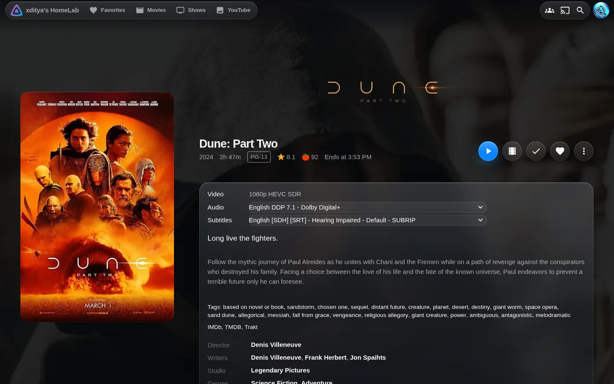
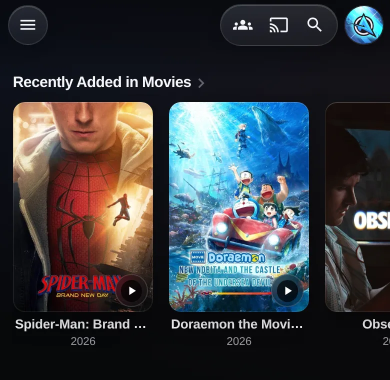
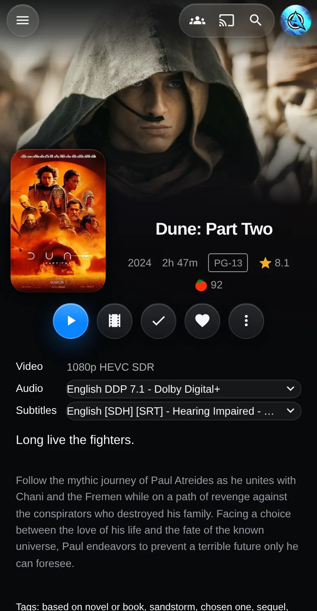
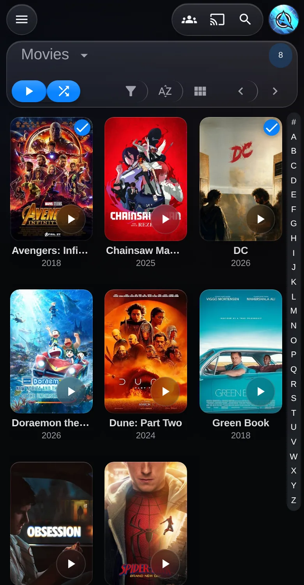
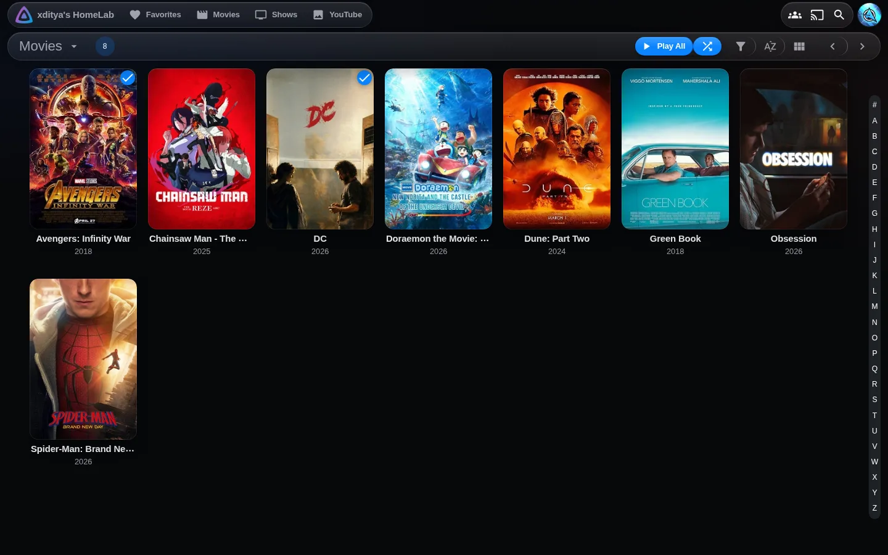

# Liquid Glass for Jellyfin

A Jellyfin web theme in the style of Apple's Liquid Glass. Your posters and backdrops stay sharp
and fill the screen. The controls float above them on frosted glass: the navigation, menus,
dialogs and player.



<table>
  <tr>
    <td></td>
    <td></td>
    <td></td>
  </tr>
</table>



## What you get

- **A floating header.** No bar across the top. The menu button, the action icons and your avatar
  each float as their own glass piece, and the page fades out underneath them.
- **Two weights of glass.** Menus, dialogs, the side drawer and the player controls get a thick,
  calm glass so text stays readable. Small buttons get a thin, light glass. Glass never sits on
  glass.
- **Posters that feel like objects.** Rounded corners, a thin light edge and a soft shadow. With a
  mouse they lift on hover. On touch screens they press in slightly instead, so nothing stays
  stuck in a hover state after a tap.
- **A cleaner details page.** The backdrop fades into the page with no hard edge. The action
  buttons are glass circles, with Play as the one solid blue button. Cast and crew photos are round.
- **Works at every size.** Phone, tablet, desktop and Jellyfin's TV layout each get spacing that
  suits them. It respects the iPhone notch and home indicator, and on TV it gives clear focus rings
  for remote control use.
- **Respects your settings.** It turns animations off for reduced motion and switches to solid
  surfaces for reduced transparency. Borders and text get stronger for increased contrast. Browsers
  without background blur get solid surfaces too.
- **Loads nothing from outside your server.** The theme is one CSS file with no web fonts. It uses
  your device's own font, which is SF Pro on iPhone, iPad and Mac.

## Works with Jellyfin Enhanced

If you use the [Jellyfin Enhanced](https://github.com/n00bcodr/Jellyfin-Enhanced) plugin, its poster
quality badges are restyled to match: one row of small smoked-glass chips instead of a stack of
coloured stickers. 4K, HDR, Dolby Vision and Atmos keep a blue tint, and the video codec chip is
hidden. Nothing changes if you don't have the plugin.

## Install

You need admin access to your Jellyfin server. Every option ends up in the same place:
**Dashboard → General → Custom CSS**.

### Option 1: one line that stays up to date

Paste this into **Custom CSS** and save:

```css
@import url("https://cdn.jsdelivr.net/gh/xditya/jellyfin-liquid-glass@main/liquid-glass.css");
```

Your browser loads the theme from jsDelivr, so you get fixes without doing anything. To stay on
one version instead, swap `@main` for a release tag such as `@v1.0.0`.

`@import` must be the first line of Custom CSS. Put any of your own rules below it.

### Option 2: paste the whole file

Copy everything in [`liquid-glass.css`](liquid-glass.css) into **Custom CSS** and save. Nothing
loads from the internet, but you update it by pasting again.

### Option 3: the install script

From a clone of this repo, on any machine that can reach your server:

```sh
export JELLYFIN_URL=http://localhost:8096
export JELLYFIN_API_KEY=your-key      # Dashboard → API Keys → +

./install.sh             # paste the whole file
./install.sh --import    # or write the one-line @import
./install.sh --remove    # back to stock Jellyfin
```

The script changes only Custom CSS and leaves your other branding settings alone. Before writing,
it saves whatever was there to `custom-css.backup.css`. It needs `curl` and `python3`.

After any option, reload Jellyfin in your browser. In the Jellyfin mobile app, close and reopen it.

## Make it yours

Add overrides after the theme in **Custom CSS**. Everything is driven by variables:

```css
@import url("https://cdn.jsdelivr.net/gh/xditya/jellyfin-liquid-glass@main/liquid-glass.css");

:root {
    --lg-accent: #ff375f;                    /* pink instead of blue */
    --lg-accent-hi: #ff6482;
    --lg-accent-soft: rgba(255, 55, 95, 0.2);
    --lg-r-card: 8px;                        /* squarer posters */
}
```

| Variable | Default | Controls |
| --- | --- | --- |
| `--lg-bg` | `#07080b` | Page background |
| `--lg-light-a`, `--lg-light-b` | faint blue, faint orange | The two soft glows in the background |
| `--lg-accent` | `#0a84ff` | Play button, selection, progress bars, focus rings |
| `--lg-accent-hi`, `--lg-accent-soft` | lighter / 20% accent | Hover tint and selected rows; change them with the accent |
| `--lg-tint-solid` | `rgba(24, 26, 33, .72)` | Glass colour for menus, dialogs, drawer, player |
| `--lg-thin` | white, 6–12% | Glass for small buttons and the header pieces |
| `--lg-blur` | `24px` (18px on phones, 12px on TV) | How frosted the thick glass is |
| `--lg-label`, `--lg-label-2`, `--lg-label-3` | Apple's dark-mode text colours | Primary, secondary and tertiary text |
| `--lg-r-card` | `14px` | Poster corner radius |
| `--lg-r-panel` | `22px` | Menus, dialogs and the details panel |
| `--lg-font` | system UI stack | Typeface |
| `--lg-fast`, `--lg-base` | `140ms`, `220ms` | Animation speed for small and large changes |

## Compatibility

- Built and tested on **Jellyfin 12.1**, in the web client and the Jellyfin mobile apps (they use
  the web client). Older 10.x versions may mostly work but aren't tested.
- **Swiftfin, Infuse, Findroid** and other native apps draw their own screens and ignore Custom CSS.
- Jellyfin doesn't apply Custom CSS on the login page, so that stays stock.
- The grey strip behind the iPhone status bar comes from a colour Jellyfin sets in its own code.
  CSS can't change it.
- The glass uses `backdrop-filter`, which every current browser supports. Real Liquid Glass bends
  light at its edges. The usual CSS trick for that, SVG displacement, doesn't work in Safari, so
  this theme doesn't use it.

## Uninstall

Clear **Dashboard → General → Custom CSS**, or run `./install.sh --remove`.

## Credits

- Structure inspired by [Phoenicx Cinema Theme](https://github.com/hansonds/Phoenicx-Cinema-Theme):
  settings first, then a bridge onto Jellyfin's palette variables, then components.
- The materials, motion and touch behaviour follow Apple's Human Interface Guidelines and WWDC
  design talks. Much of that came by way of [Emil Kowalski's skills](https://github.com/emilkowalski/skills)
  (`apple-design`, `emil-design-eng`, `mobile-native`).
- Not affiliated with Apple or Jellyfin.

## License

[MIT](LICENSE)
